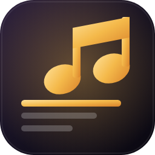

# Lyric Player

A Windows (and experimental Linux) desktop player for your YouTube Music playlists, albums and single songs.
Lyrics on the left, the album art on the right, controls along the bottom. The colors follow the album art of the current song.
Songs play through the real YouTube Music website (kept out of sight inside the app), so songs that can't be played in other apps still work.

## 1. Run it (Windows)

**Requirement:** Node.js LTS from https://nodejs.org (one-time install).

| Step | What to do |
|---|---|
| 1 | Unzip the folder anywhere. |
| 2 | Double-click **Start.bat**. The first run installs what it needs (a few minutes, needs internet). |
| 3 | Drag a playlist, album or song link onto the window, or paste it and press **Load**. |

The app remembers what you were playing (playlist, album or song), the exact spot, and your shuffle, repeat and layout settings, and picks up from there next time.

## 2. Getting your playlist in

| Method | How |
|---|---|
| Drag and drop | In YouTube Music (browser), drag the playlist's link or card onto the app window. |
| Paste | In YouTube Music: playlist, album or song > **Share** > **Copy link**, then paste in the box. A single song plays on its own and stops at the end (Repeat plays it again). |
| Accepted links | Anything containing `list=...` (music.youtube.com or youtube.com). A bare ID like `PLxxxxxxxx` also works. |
| Spotify, Deezer, SoundCloud | Paste a public playlist (or album) link. Each song is matched on YouTube Music one by one (it takes a moment), the matches go into the queue, and you're told "Found X of Y" with a list of the songs that weren't found. Playback is always YouTube Music. Spotify may only list the first ~100 songs, at most 200 are imported, and SoundCloud is best-effort. |
| Saved playlists | Imported playlists, and any YouTube Music playlist or album you start, are remembered in **Change music > Saved playlists** (up to 30), each with Play, + Queue and ✕. Imported ones open instantly with no new searching; **Update** re-imports. |

**No sign-in needed** for Public or Unlisted playlists. A Private playlist needs you to sign in: click **YouTube Music** at the top, sign in there once, and the app remembers it. (Google sometimes refuses sign-ins inside apps. If so, set the playlist to Unlisted instead: YouTube Music > your playlist > **Edit** > **Privacy** > **Unlisted**.)

## 3. Lyrics

**Automatic:** when a song has no lyrics file yet, the app looks it up on LRCLIB (a free public lyrics database). If LRCLIB has nothing or can't be reached, it tries two backups: NetEase Cloud Music (for timed lyrics) and lyrics.ovh (plain text). It saves what it finds into your lyrics folder, so each song is only looked up once. Timed lyrics scroll along with the song, and the line being sung grows and glows, then shrinks back when the next line starts. If a song has no lyrics, the album slides to the middle of the window and slides back to the normal layout when the next song has lyrics. The **Add lyrics** button under the song title is there for that case. Turn this off with the **Auto lyrics** button at the top.

**Quran recitations:** if a song's title looks like a recitation (for example "Surah Al-Kahf", "Surah Yaseen (1-10)", "Ayatul Kursi", or a surah name by a well-known reciter), the app shows the Arabic text with an English translation from Al-Quran Cloud (free). It's plain text, not timed, so you scroll it yourself. A title range like (1-10) shows just those ayahs. Normal songs and nasheeds are never treated as recitations. If a title isn't recognised, use **Add lyrics**.

Only the song title, artist and length are sent to these services. If a song isn't in their database you'll see "Couldn't find lyrics online", and you can paste your own.

**Your own files:** lyrics are plain files in your **lyrics folder** (button, top right). Default location:
`Documents\Lyric Player\lyrics`

| Item | Detail |
|---|---|
| Naming | The file name should match the song title, e.g. `Midnight Run.txt` or `Midnight Run.lrc`. |
| Matching | Case, punctuation, "(Official Audio)" and a leading track number like `02 - ` are ignored. |
| Plain text | `.txt`, shows the lyrics and you scroll. |
| Timed | `.lrc`, lines light up and scroll in time. Click any line to jump the song to it. |
| Your own lyrics win | A file you add or edit is always used before any online lookup. Fetched files can be edited with **Edit lyrics**. |
| Add manually | Click **Add lyrics** while a song plays, paste, **Save**. The file is created for you. Include timestamps and it saves as `.lrc`. |
| Format example | See `lyrics-examples\Sample Song.lrc`. |

Timestamp format: `[minutes:seconds.hundredths] line`, for example `[01:12.50] your line here`.

## 3b. Hiding explicit album covers

| Item | Detail |
|---|---|
| Automatic | Each cover is checked on your computer by a small image model (NSFWJS, free, offline). Covers it judges explicit are blurred and labeled "Cover hidden". Other covers show as normal. |
| Your choice wins | Hover over the album and click **Hide cover** or **Show cover**. The choice is remembered for that album. |
| Turn it off | **Cover filter: on/off** at the top. Your Hide choices still apply. |
| First cover | The model loads (about 8 MB) the first time a cover is checked, so the first cover stays blurred for a second or two. |
| Limits | No automatic check is perfect. Artistic nudity can be missed, and some harmless covers can be blurred. That is what the Hide and Show buttons are for. |

## 4. Controls

| Control | Action |
|---|---|
| Shuffle | The app reads the playlist's song list and picks a random song each time, without repeating until every song has played. Back returns to the song that played before. Shuffle can take a second or two to switch songs. |
| Previous | Restarts the song if you're past 3 seconds, otherwise goes to the previous song. |
| Play / Pause | Also the **Space** bar. |
| Next | Also **Ctrl + Right**. Previous is **Ctrl + Left**. |
| Repeat | Cycles: off > repeat playlist > repeat this song (badge shows 1). Both Shuffle and Repeat are handled by this app, not by YouTube Music's own buttons, and are remembered next time. |
| Fullscreen | The corner button on the bottom left, or **F11**. Hides the top buttons; the controls fade out when the mouse is still. **Esc** exits. |
| YouTube Music | Shows the YouTube Music page (browse, sign in). Click again to go back to lyrics. |
| Update available | A button that appears at the top when a newer version has been published. Click it to download the new .exe, then close the app and run the new file instead. The app checks quietly after it starts, at most every 6 hours. |
| Mini player | A small always-on-top pill with the cover, song, artist and one rolling lyric line, in the cover's colours. Drag it anywhere (it remembers where). Hover for previous / play / next; otherwise it shows what plays next. Double-click it, or press the expand button, to bring back the full window. |

## 5. Make a standalone .exe (optional)

Double-click **Build-EXE.bat**. When it finishes, the portable `Lyric-Player-1.0.0.exe` is in the `dist` folder. You can copy that single file to any Windows PC.

## 6. Troubleshooting

| Problem | Fix |
|---|---|
| Nothing happens after pasting | Click **YouTube Music** at the top. If the page is asking you to accept cookies or confirm something, do that, then click **Back to lyrics**. |
| "Taking longer than expected" | Same as above. The page is probably waiting for you. |
| Ads still play | Ad block is on by default (button at the top) but YouTube changes its ads often. The app mutes and fast-forwards any ad that gets through. If one plays in full, tell me and I'll update the rules. |
| Back, Next, Shuffle or Repeat misbehave | Press **Ctrl + Shift + D**. It copies a short troubleshooting report to the clipboard. Paste it into a message to me. |
| Song title or art doesn't update | YouTube may have changed its page. Press **F12** and tell me what you see. |
| "Couldn't find lyrics online" | The song isn't in LRCLIB or either backup, or its title is unusual. Use **Add lyrics** to paste them. |
| "Couldn't reach the lyrics service" | Check your internet connection. It retries the next time the song plays. |
| Wrong lyrics were saved | Open the lyrics folder, delete that file (or fix it with **Edit lyrics**). |
| Lyrics don't appear for a file you added | Check the file name matches the song title, and the file is `.txt` or `.lrc` in the lyrics folder. Click the window to refresh the list. |
| Covers don't blur | If the model can't start, covers are shown normally and a message says so. Use **Hide cover** on any cover you want hidden. |
| Port in use | The app uses a local-only port (47831) and picks another automatically if it's busy. |

## 7. How it works and its limits

- The app opens music.youtube.com in a hidden view and reads the song title, artist, art and time from it. The buttons at the bottom press the same controls on that page.
- Your playlist, listening and (if you sign in) account are handled by YouTube Music itself, not by this app.
- If YouTube changes its page layout, reading the song info or pressing a control can break until the app is updated.
- Lyrics come from your own files first, then from LRCLIB, then the two backups (NetEase, lyrics.ovh). The online lookup sends only the song title, artist and length.
- Ad block works three ways: it blocks known ad servers, removes ad data from YouTube's responses before the player sees it, and mutes and skips any ad that still starts. YouTube's terms discourage ad blocking, and it can stop working whenever YouTube changes its page. YouTube Music Premium is the supported way to avoid ads.
- Timed lyrics depend on volunteers who contribute to LRCLIB. A few songs only have plain lyrics, and some have none.

## 8. Developer notes

| Command | Purpose |
|---|---|
| `npm install` | Install dependencies |
| `npm start` | Run the app |
| `npm test` | Run the lyrics parser tests |
| `npm run dist` | Build the portable .exe into `dist\` |

Files: `main.js` (window, local server, settings, lyrics files), `preload.js` (safe bridge), `renderer/` (UI: `index.html`, `style.css`, `app.js`, `lyrics.js`).
